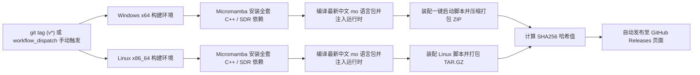

# GNU Radio 简体中文汉化版 (gnuradio_zhcn)

[](https://www.python.org/)
[](https://www.gnu.org/licenses/gpl-3.0)
[](https://github.com/gfgf2023/gnuradio_zhcn)
[](https://github.com/gfgf2023/gnuradio_zhcn/actions/workflows/release.yml)

**GNU Radio 简体中文版 (`gnuradio_zhcn`)** 是面向广大中文无线电爱好者、SDR 开发者、科研学者、高校师生及通信工程师的开源深度本地化与增强发行项目。在保持与 GNU Radio 官方底层 C++ 核心库及流图代码生成 100% 兼容的前提下，本项目彻底解决了 GNU Radio Companion (GRC) 长期缺乏中文支持、菜单与 500+ 个专业模块全是英文的技术使用门槛，并提供**开箱即用、免安装编译的绿色便携版**。

---

## 🌟 核心特性 (Key Features)

### 1. 核心 DSP 模块 100% 深度汉化
- **全模块覆盖**：官方全部 **575 个核心 DSP 模块**及 **20 个核心大类** 100% 汉化，杜绝半生不熟的界面与生硬机翻。
- **涵盖分类**：
  - 核心组件、音频处理、数字滤波器、傅里叶分析 / 频域处理；
  - 模拟与数字调制解调器、正交频分复用 (OFDM)、基带信道均衡；
  - 差错控制与纠错编码 (FEC)、信道恶化与损伤模型、IQ 正交失衡校准；
  - 工业级 I/O (IIO / AD9361)、测量仪表与探针、电平与自动增益控制 (AGC)；
  - 数学算术运算、信号度量与分析工具、消息总线与异步 PDU、流标签 (Stream Tag) 工具；
  - 时域重采样器、时钟与数据同步器、数据包与帧结构操作；
  - SoapySDR 通用硬件、USRP 硬件驱动 (UHD) 等。
- **对话框参数全面中文化**：模块属性对话框中的关键参数（`采样率`、`中心频率`、`增益`、`截止频率`、`过渡带宽`、`波形类型`、`窗函数` 等）及选项值全部采用符合国内教科书及通信工程标准的术语。

### 2. PyQt6 现代化深色主题 (Dark Mode)
- 基于最新 PyQt6 图形框架与原生 QDarkStyle 深色暗黑主题开发，长时间流图设计与频谱观察护眼舒适。

### 3. 中英双语与拼音智能检索 (Dual-Language & Pinyin Search)
- 左侧模块库搜索栏支持实时模糊搜索：
  - **中文搜索**：输入“正弦”、“低通”、“示波器”、“速率限制”、“混频”等；
  - **拼音搜索**：输入全拼或拼音缩写；
  - **英文原名**：输入 `signal source`、`throttle`、`time sink` 等原生 ID 均可即时命中。

### 4. 实时控制台反馈与运行诊断
- 代码生成 (`生成代码 (G)`) 与流图执行 (`运行 (R)`) 具备弹窗即时状态提示。
- 底部控制台集成 Python 实时输出流，执行报错时智能高亮并提示排查建议。

### 5. 全功能绿色免安装发行包 (Zero-Config Portable)
- **免安装、无须环境配置**：免去 Windows 下长达数小时复杂的 MSVC / CMake / GCC 编译与驱动配置困扰。
- **内置全功能运行时**：包含 Python 3.11、GNU Radio C++ 核心库、VOLK 矢量优化、PyQt6、QDarkStyle、NumPy、SciPy、Matplotlib。
- **集成主流 SDR 驱动**：即插即用支持 RTL-SDR、HackRF One、PlutoSDR、USRP、Airspy 等主流硬件。

---

## 🚀 快速使用 (Quick Start)

### 方式一：下载 GitHub Actions 自动编译的全功能发行包（强烈推荐）
1. 进入本项目的 [Releases 发行版页面](https://github.com/gfgf2023/gnuradio_zhcn/releases)。
2. 下载最新版本的 Windows 绿色免安装包：`gnuradio-v*-windows-x64-portable-zhCN.zip`。
3. 解压至任意英文目录（如 `D:\gnuradio_zhcn`）。
4. **双击 `一键启动-GNU Radio中文版.bat`** 即可直接进入中文 GRC 界面！
5. （可选）双击 `创建桌面快捷方式.vbs` 可在桌面生成启动图标。

### 方式二：源码仓库直接预览或开发调试
如果本机已安装 Python 3.10+ 及 PyQt6：
```bash
# 安装基础 GUI 依赖
pip install PyQt6 pyyaml mako qdarkstyle

# 启动中文版 GRC
python grc_zhcn.py

# 打开指定的流图文件
python grc_zhcn.py demo_zhcn.grc

# 运行自动化单元测试
python -m pytest grc/tests/test_translation_zhcn.py
```

### 方式三：本地一键打包绿色发行版
若本机需要制作分发包：
```bash
# 双击运行或在命令行执行：
tools\build_portable_release.bat
```
打包生成的文件将存放在 `dist/` 目录下，并自动计算 SHA256 校验码。

---

## 🛠️ GitHub Actions 自动化编译流程

本项目已配置完整的 GitHub Actions CI/CD 流水线（`.github/workflows/release.yml`）：



### 触发 Actions 编译发行包的方式：
1. **发布新版本 Tag 自动触发**：
   ```bash
   git tag v3.11.0.0-zhcn
   git push origin v3.11.0.0-zhcn
   ```
2. **在 GitHub 网页上手动 1-Click 触发**：
   - 打开 GitHub 仓库页面，点击顶部 **Actions** 标签卡；
   - 在左侧选择 **Build & Release Full-Featured Packages** 流水线；
   - 点击右侧 **Run workflow** 按钮，输入版本号并点击确认，Actions 将自动编译并上传全功能安装包至 Release！

---

## 📻 SDR 硬件连接与驱动配置

在 Windows 下使用 USB 接口的 SDR 设备（如 RTL-SDR / HackRF），通常需要配置 WinUSB 驱动：
1. 将硬件设备插入电脑 USB 接口；
2. 下载并打开 [Zadig 驱动工具](https://zadig.akeo.ie/)；
3. 点击菜单【Options】-> 勾选【List All Devices】；
4. 下拉选择你的 SDR 设备（如 `Bulk-In, Interface (Interface 0)` 或 `HackRF One`）；
5. 目标驱动选择【WinUSB】，点击【Replace Driver】；
6. 双击运行发行包内的 `启动-SDR命令行终端.bat`，输入：
   ```bash
   SoapySDRUtil --find
   ```
   若输出中成功识别硬件，即可在流图中使用！

---

## 🤝 参与贡献与翻译校订

欢迎广大学者与工程技术人员共同维护无线电技术术语的汉化：
- 翻译源文件：`grc/gui_qt/resources/language/zh_CN/LC_MESSAGES/grc.po`
- 编译语言包：`python tools/compile_po.py`
- 校验测试：`python -m pytest grc/tests/test_translation_zhcn.py`

---

## 📄 开源许可证

本项目遵循与官方 GNU Radio 相同的开源许可协议：[GNU General Public License v3.0 (GPL-3.0)](COPYING)。
